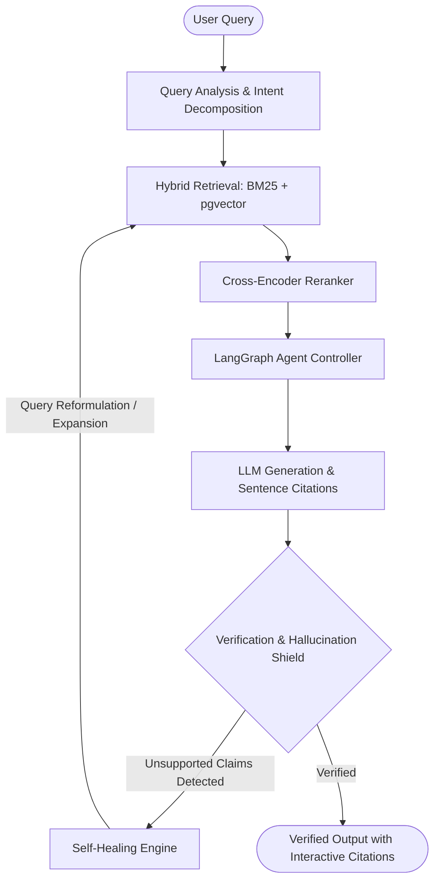

# Self-Healing RAG Agent

[](docs/roadmap.md)
[](https://fastapi.tiangolo.com/)
[](https://react.dev/)
[](https://www.sqlalchemy.org/)
[](https://github.com/pgvector/pgvector)
[](https://github.com/dorianbrown/rank_bm25)
[](https://github.com/PrithivirajDamodaran/FlashRank)
[](LICENSE)


An enterprise-grade, agentic AI retrieval and knowledge platform built for zero-hallucination, self-correcting information synthesis.

---

## 1. Project Overview

The **Self-Healing RAG Agent** is an enterprise AI knowledge and retrieval platform engineered to overcome the inherent fragility of traditional Retrieval-Augmented Generation (RAG) pipelines. 

While typical RAG systems execute a naive, one-way sequential pipeline (Query → Embedding → Vector Search → Prompt → LLM), the Self-Healing RAG Agent implements **agentic cyclic evaluation loops**: verifying generated claims against raw retrieved evidence, detecting retrieval and factual anomalies in real time, and triggering automated recovery strategies.

---

## 2. The Problem with Traditional RAG

Standard production RAG systems consistently fail in enterprise deployments due to five critical vulnerabilities:

1. **Poor Retrieval Quality**: Semantic vector similarity frequently misses exact keyword terms (SKUs, IDs, domain jargon) while lexical search misses semantic nuance.
2. **Missing & Fragmented Context**: Naive document chunking breaks critical relationships across paragraphs, leading to incomplete or out-of-context facts.
3. **Hallucination & Fabrication**: Large Language Models fill contextual gaps with plausible-sounding hallucinations without validating their statements against original source text.
4. **Conflicting Sources**: Enterprise corpora contain contradictory guidelines or multi-version document policies that naive RAG feeds blindly to LLMs without reconciling dates or authorities.
5. **Stale Knowledge & Silent Degradation**: Once retrieval fails, traditional pipelines return empty or low-relevance snippets directly to the LLM, producing confident but erroneous answers with zero automated recovery.

---

## 3. The Vision: Self-Healing Architecture

The final vision of this platform is a **closed-loop, self-correcting retrieval graph**:



---

## 4. Quick Demo Login & Authentication Modes

> **PRODUCTION-READY**: This platform delivers a production-grade, real authentication, authorization, session management, and multi-tenancy foundation.
> Features Argon2id password encryption, rotated refresh token families, short-lived JWT access tokens, HttpOnly secure cookies, server-side RBAC (USER / ADMIN), session revocation, automated token reuse detection, audit logging, and responsive enterprise authentication screens.

### Development Demo Login (Quick Access)

For streamlined local development and evaluation without manually entering credentials every time, a development-only Demo Login is available:

- **Demo Account Email**: `demo@selfhealingrag.local`
- **Demo Account Name**: `Jeeva Developer`
- **Assigned RBAC Role**: `USER` (Regular user privileges; server-enforced)
- **Authentication Realism**: The demo login endpoint (`POST /api/v1/auth/demo-login`) issues a **real** JWT access token, creates an active cryptographic session in PostgreSQL (`user_sessions`), sets a secure `HttpOnly` refresh cookie, and logs an audit record (`DEMO_LOGIN_SUCCESS`).
- **Security Boundary**: Strictly blocked (returns HTTP 403 Forbidden) if `DEMO_LOGIN_ENABLED=false` or if the active environment is `production`.
- **Production Guardrail**: *This feature is for local development/demo access only and must remain disabled in production (`DEMO_LOGIN_ENABLED=false`).*

#### Enabling Demo Login Locally
In your `.env` file:
```env
ENVIRONMENT=development
DEMO_LOGIN_ENABLED=true
VITE_DEMO_LOGIN_ENABLED=true
```

#### Disabling Demo Login (Production Default)
```env
ENVIRONMENT=production
DEMO_LOGIN_ENABLED=false
VITE_DEMO_LOGIN_ENABLED=false
```


---

## 5. System Architecture

The codebase enforces strict **Clean Onion Architecture**:

```text
Presentation Layer (React 19 + TypeScript + Vite + Tailwind CSS)
      ↓
API Layer (FastAPI /api/v1/ with Correlation ID Tracing)
      ↓
Application / Service Layer (HealthService, SystemService)
      ↓
Domain Layer (Abstractions: LLM, Embeddings, VectorStore, Reranker, Storage)
      ↓
Infrastructure Layer (SQLAlchemy 2.0 Async, Redis, pgvector, Alembic)
```

---

## 6. Technology Stack

### Backend
- **Language**: Python 3.11+ / Python 3.13
- **Framework**: FastAPI 0.115+
- **Validation**: Pydantic v2 & Pydantic Settings
- **Database ORM**: SQLAlchemy 2.0 (AsyncIO engine with asyncpg)
- **Migrations**: Alembic (Async runner)
- **Vector Storage**: PostgreSQL 16+ with `pgvector` extension
- **Cache & State**: Redis 7+ (`redis.asyncio`)
- **Server**: Uvicorn with standard ASGI workers
- **Testing & Quality**: Pytest, Pytest-AsyncIO, HTTPX, Ruff

### Frontend
- **Framework**: React 19 + TypeScript (Strict mode)
- **Bundler**: Vite 6+
- **Styling**: Tailwind CSS v4 + custom HSL design system
- **Icons**: Lucide React
- **Server State**: TanStack Query v5
- **Routing**: React Router v6
- **Forms & Validation**: React Hook Form + Zod
- **Topology Visuals**: React Flow (`@xyflow/react`)
- **Charts**: Recharts

---

## 7. Monorepo Structure

```text
Self-Healing RAG Agent/
├── backend/
│   ├── app/
│   │   ├── api/
│   │   │   ├── routes/          # Health, System, and future module routers
│   │   │   └── router.py        # Central /api/v1 router
│   │   ├── core/                # Config, structured logging, errors, middleware
│   │   ├── domain/              # Swappable interfaces (LLM, Embeddings, VectorStore)
│   │   ├── infrastructure/      # Database session, Redis client, models
│   │   ├── repositories/        # Generic async CRUD & Audit repositories
│   │   ├── schemas/             # Pydantic request/response envelopes
│   │   ├── services/            # Application business services
│   │   └── main.py              # FastAPI app factory
│   ├── tests/                   # Pytest automated test suite
│   ├── alembic/                 # Database migrations
│   ├── alembic.ini              # Alembic migration configuration
│   ├── pyproject.toml           # Ruff, Pytest, and Mypy configurations
│   ├── requirements.txt         # Core dependencies
│   └── requirements-dev.txt     # Development & testing dependencies
│
├── frontend/
│   ├── src/
│   │   ├── components/          # UI, Layout, and Common components
│   │   ├── pages/               # Route pages (Dashboard, Chat, KB, etc.)
│   │   ├── routes/              # React Router browser routes
│   │   ├── hooks/               # Custom hooks (useHealth)
│   │   ├── services/            # API client and health service
│   │   ├── constants/           # Navigation and roadmap constants
│   │   ├── lib/                 # Utility helpers
│   │   ├── types/               # TypeScript domain types
│   │   ├── App.tsx              # Application shell with React Query
│   │   └── main.tsx             # React DOM entry point
│   ├── package.json             # NPM dependencies & scripts
│   ├── tsconfig.json            # Strict TypeScript configuration
│   └── vite.config.ts           # Vite bundler configuration
│
├── docker/
│   ├── Dockerfile.backend       # Python 3.11 production container
│   ├── Dockerfile.frontend      # Multi-stage Node + Nginx SPA container
│   └── postgres/                # PostgreSQL init scripts (pgvector)
│
├── docs/                        # Architecture, API, DB, Dev, and Roadmap docs
├── scripts/                     # PowerShell and bash developer scripts
├── .env.example                 # Environment configuration template
├── .gitignore                   # Git exclusion rules
├── docker-compose.yml           # Multi-container orchestration
├── Makefile                     # Cross-platform development tasks
└── README.md                    # Project master documentation
```

---

## 8. Quickstart & Local Setup

### 1. Clone & Configure Environment
```bash
git clone <repository-url>
cd "Self-Healing RAG Agent"
cp .env.example .env
```
Ensure your `.env` contains valid connection settings for PostgreSQL (with `pgvector` enabled) and optional LLM keys (`GROQ_API_KEY` for inference, `OPENAI_API_KEY`, etc.). Placeholders in `.env.example` illustrate the required schema.

### 2. Database Prerequisites & Migrations
Ensure PostgreSQL 16+ is running with `pgvector` installed.
```powershell
# Apply database migrations to head
backend\.venv\Scripts\alembic.exe -c alembic.ini upgrade head
```

### 3. Backend Execution
The backend entry point is `app.main:app` inside the `backend/` directory.

**Option A (From Workspace Root via PowerShell):**
```powershell
backend\.venv\Scripts\uvicorn.exe app.main:app --reload --host 127.0.0.1 --port 8000
```

**Option B (From `backend` directory):**
```powershell
cd backend
.\.venv\Scripts\python -m uvicorn app.main:app --reload --host 127.0.0.1 --port 8000
```

**Backend Health Checks:**
- Liveness Probe: `http://127.0.0.1:8000/api/v1/health`
- Readiness Probe (DB/Redis/pgvector check): `http://127.0.0.1:8000/api/v1/health/ready`
- Interactive OpenAPI Docs: `http://127.0.0.1:8000/api/v1/docs`

### 4. Frontend Execution
> **Note on Root Directory Execution**: Running `npm run dev` from the workspace root previously produced `npm error code ENOENT: Could not read package.json` because frontend code lives in `frontend/`. A root `package.json` proxy is now configured so commands work from both locations.

**Option A (From Workspace Root — Recommended):**
```powershell
# Start Vite development server (http://localhost:5173)
npm run dev

# Run production build & TypeScript type check
npm run build

# Run Vitest test suite
npm run test
```

**Option B (From `frontend` Subdirectory):**
```powershell
cd frontend
npm install
npm run dev
```

### 5. Running with Docker Compose
```bash
docker compose up -d
```
Services started:
- **Frontend**: http://localhost:5173
- **Backend API**: http://localhost:8000
- **FastAPI Docs**: http://localhost:8000/api/v1/docs
- **PostgreSQL**: `localhost:5432` (with pgvector)
- **Redis**: `localhost:6379`

---

## 9. Automated Testing & Verification

Run the automated test suites using the project configuration:

```powershell
# 1. Backend Pytest Suite (272 passed)
backend\.venv\Scripts\pytest -o pythonpath=backend backend\tests

# 2. Backend Linting (Ruff - 0 errors)
backend\.venv\Scripts\ruff check backend\app backend\tests

# 3. Frontend Vitest Suite (46 passed)
npm run test
# Or from frontend: cd frontend && npm test

# 4. Frontend Type-Check & Production Build
npm run build
# Or from frontend: cd frontend && npm run build
```

---

## 10. Platform Capability Matrix

| Module | Core Functionality | Verified Status |
| :--- | :--- | :---: |
| **System Architecture** | Clean Onion Architecture with FastAPI, SQLAlchemy 2.0 Async, Pydantic v2 | **Operational** |
| **Authentication & RBAC** | Argon2id hashing, rotated refresh token families, JWTs, role authorization | **Operational** |
| **Document Ingestion** | Multi-format parsers (PDF, DOCX, TXT, MD, CSV), structure-aware chunking | **Operational** |
| **Dense Embeddings** | FastEmbed (`BAAI/bge-small-en-v1.5`, 384d) with `pgvector` indexing | **Operational** |
| **Hybrid Search & Rerank** | Dense vector similarity + BM25Okapi + Reciprocal Rank Fusion + FlashRank | **Operational** |
| **Grounded LLM Generation** | Groq Llama 3.3 generation, citation validation, refusal on insufficient evidence | **Operational** |
| **Multi-Agent Orchestration**| LangGraph cyclic state graph with query understanding, planning, & verifiers | **Operational** |
| **Self-Healing Recovery** | Bounded autonomous recovery policies, adaptive query expansion, retry safeguards | **Operational** |
| **Evaluation Benchmark** | Precision, recall, groundedness, and citation fidelity benchmarks | **Operational** |
| **Distributed Observability**| OpenTelemetry trace waterfall, token/cost attribution, error taxonomy | **Operational** |
| **Knowledge Intelligence** | Granular health checks, exact/near-duplicate detection, versioned re-indexing | **Operational** |

---

## 11. Authentication, Multi-Tenancy & RBAC Architecture

### Security & Token Architecture
- **Password Encryption**: Modern **Argon2id** (memory-hard, resistant to GPU/ASIC cracking) via `argon2-cffi`.
- **Access Tokens**: Short-lived (15 minutes default) signed **HMAC-SHA256 JWTs** containing minimal claims (`sub`, `role`, `type="access"`, `iat`, `exp`, `jti`).
- **Refresh Tokens**: Cryptographically secure URL-safe tokens stored as **SHA-256 hashes** in the database (`user_sessions` table). Plaintext refresh tokens are never persisted.
- **Refresh Token Rotation**: Every refresh consumes the old token and issues a new refresh token within the same cryptographic `token_family`.
- **Token Reuse Detection**: If an already rotated or revoked refresh token is presented, the system detects replay/interception and **immediately invalidates the entire token family**, logging a high-priority security audit event.
- **Cookie Security**: Refresh tokens are delivered via `HttpOnly`, `SameSite=Lax`, and `Secure` (in production) cookies, completely inaccessible to JavaScript XSS attacks.
- **Server-Side RBAC**: Authorization boundaries are enforced on the backend via dependency injection (`require_role(...)`, `require_admin`). Frontend guards are strictly for UX.
- **Audit Logging**: All security events (`USER_REGISTERED`, `USER_LOGIN_SUCCESS`, `USER_LOGIN_FAILED`, `USER_LOGOUT`, `TOKEN_REFRESHED`, `TOKEN_REVOKED`, `TOKEN_REUSE_DETECTED`, `PASSWORD_CHANGED`) are persisted to `audit_logs` table without leaking credentials.

---

## 12. Knowledge Base & Document Ingestion Architecture

### Core Architecture Concept
```
User
 ↓
Knowledge Base
 ↓
Documents
 ↓
Document Versions
 ↓
Chunks
 ↓
Embeddings (pgvector)
```

### Document Ingestion Pipeline
1. **Upload & Validation**: Validates file extension against allowed formats (PDF, DOCX, TXT, MD, CSV) and size limit (50MB). Sanitizes filenames to eliminate path traversal.
2. **Deduplication via SHA-256**: Generates SHA-256 checksums per document. Rejects duplicate uploads within the same Knowledge Base (HTTP 409 Conflict).
3. **Safe Storage Abstraction**: Original files are persisted safely through `ObjectStorageInterface` with local filesystem provider (`LocalStorageProvider`), preventing arbitrary path traversal.
4. **Multi-Format Parsers**:
   - **PDFParser** (`pypdf`): Extracts pages preserving 1-indexed page boundaries. Detects image-only/scanned documents without pretending OCR succeeded (`UNSUPPORTED_SCANNED_DOCUMENT`).
   - **DOCXParser** (`python-docx`): Extracts structured headings, paragraphs, and tables preserving section titles.
   - **MarkdownParser**: Extracts sections while preserving Markdown hierarchy, code blocks, lists, and headings.
   - **CSVParser**: Detects headers and rows, converting tabular records into semantic key-value text representations suitable for dense vector embedding.
   - **TextParser**: Parses plain text documents preserving paragraphs.
5. **Text Normalization**: Unicode NFC normalization, control character stripping, CRLF unification, and whitespace cleanup without altering code, markdown, tables, or URLs.
6. **Intelligent Structure-Aware Chunking**:
   - Configurable token chunk size (`CHUNK_SIZE=500`) and overlap (`CHUNK_OVERLAP=50`).
   - Respects structural section boundaries, headings, and natural sentence/paragraph breaks.
   - Captures comprehensive citation metadata: `document_id`, `document_version_id`, `chunk_index`, `page_number`, `section_title`, `start_offset`, `end_offset`, `token_count`, `character_count`.
7. **Dense Vector Embeddings & pgvector Storage**:
   - Model: **`BAAI/bge-small-en-v1.5`** (384-dimensional dense vectors) running locally via **FastEmbed** and ONNX Runtime.
   - Database: Persisted in PostgreSQL using **`pgvector`** with HNSW indexing (`vector_cosine_ops`).
   - Versioning Metadata: Every chunk stores `embedding_model`, `embedding_provider`, and `embedding_dimension` for migration resilience.
8. **Reprocessing & Cascading Lifecycle**:
   - `POST /api/v1/documents/{id}/reprocess`: Safely clears existing chunks and re-embeds the stored document.
   - Deleting a document or Knowledge Base cascades across physical storage files, versions, chunks, and database records without orphaned objects or user records.

### Knowledge Base API Endpoints
- `POST /api/v1/knowledge-bases` — Create Knowledge Base.
- `GET /api/v1/knowledge-bases` — List user's Knowledge Bases with pagination.
- `GET /api/v1/knowledge-bases/{id}` — Retrieve Knowledge Base details with live document and chunk counts.
- `PATCH /api/v1/knowledge-bases/{id}` — Update Knowledge Base name or description.
- `DELETE /api/v1/knowledge-bases/{id}` — Delete Knowledge Base and cascade-clean all child documents, chunks, and stored files.
- `POST /api/v1/knowledge-bases/{id}/documents` — Multipart file upload (202 Accepted) initiating background ingestion.
- `GET /api/v1/knowledge-bases/{id}/documents` — Paginated list of documents in Knowledge Base.
- `GET /api/v1/documents/{id}` — Document status, chunk count, and ingestion error details.
- `GET /api/v1/documents/{id}/chunks` — Paginated list of document chunks with citation metadata.
- `DELETE /api/v1/documents/{id}` — Delete document and clean up physical storage and vector chunks.
- `POST /api/v1/documents/{id}/reprocess` — Re-triggers parsing, chunking, and dense embedding for stored document.

---

## 13. Advanced Hybrid Retrieval & Neural Reranking Engine

```
                             User Query
                                 │
                 ┌───────────────┴───────────────┐
                 ▼                               ▼
       Vector Retrieval                  Lexical Retrieval
   (BAAI/bge-small-en-v1.5)           (BM25Plus & GIN Index)
                 │                               │
                 └───────────────┬───────────────┘
                                 ▼
                     Reciprocal Rank Fusion
                   RRF(d) = Σ 1 / (k + rank_i)
                                 │
                                 ▼
                    Cross-Encoder Reranking
                 (FlashRank / TinyBERT ONNX)
                                 │
                                 ▼
                    Final Ranked Results &
                    Latency Audit Breakdown
```

### Core Pipeline Components
1. **Semantic Vector Search (`VectorRetriever`)**:
   - Uses **`BAAI/bge-small-en-v1.5`** (384-dimensional dense vectors) matching ingested document chunks.
   - Enforces strict model identity, embedding dimension compatibility (384-d), and server-side Knowledge Base owner authorization.
   - Query embedding is computed on-the-fly and matched against document chunks via pgvector cosine distance / NumPy vectorization with configurable similarity thresholds.
2. **Lexical Keyword Search (`BM25Retriever`)**:
   - Implements **`BM25Plus`** with lower-bound delta smoothing ($\delta=1.0$, $k_1=1.5$, $b=0.75$) to prevent negative IDF values on small or single-document corpora.
   - Backed by PostgreSQL GIN full-text index `ix_document_chunks_content_tsv` generated via Alembic migration `0004_retrieval_search_indexes`.
   - Supports exact keywords, technical terms, identifiers, and acronyms with alphanumeric tokenization and stop-word filtering.
3. **Reciprocal Rank Fusion (`ReciprocalRankFusion`)**:
   - Fuses ranked lists independently by stable chunk UUID:
     $$\text{RRF\_score}(d) = \sum_{r \in \mathcal{R}} \frac{1}{k + \text{rank}_r(d)}$$
   - Default smoothing constant $k = 60$.
   - Deterministic tie-breaking preserving original retriever ranks, raw scores, and stage provenance (`vector`, `lexical`, or `hybrid`).
4. **Cross-Encoder Neural Reranking (`FlashRankReranker`)**:
   - Employs **`ms-marco-TinyBERT-L-2-v2`** running locally via ONNX Runtime on CPU for low-latency, zero-external-API relevance scoring.
   - Evaluates concatenated (query, chunk_text) pairs and outputs calibrated relevance probabilities without reloading model weights on requests.
   - Configurable candidate limits (`candidate_limit`, default 20) and final results (`top_k`, default 5).
5. **Retrieval Provenance & Latency Instrumentation**:
   - Every returned result contains full audit provenance: `vector_rank`, `vector_score`, `lexical_rank`, `lexical_score`, `rrf_rank`, `rrf_score`, `reranker_rank`, `reranker_score`, and `stage_provenance`.
   - Complete stage-by-stage millisecond latency telemetry: `embedding_ms`, `vector_search_ms`, `lexical_search_ms`, `fusion_ms`, `reranking_ms`, and `total_ms`.

### Retrieval & Reranker API Endpoints
- `POST /api/v1/retrieval/search` — Primary hybrid retrieval endpoint with configurable mode (`hybrid`, `vector`, `lexical`), candidate limit, top-k, and reranking toggle.
- `POST /api/v1/retrieval/compare` — Comparative endpoint executing Vector, Lexical, and Hybrid retrieval simultaneously side-by-side with latency benchmarking.
- `POST /api/v1/search` — Direct backward-compatible alias for the retrieval search endpoint.

### Example Search Request & Response
```bash
curl -X POST "http://localhost:8000/api/v1/retrieval/search" \
  -H "Authorization: Bearer <JWT_ACCESS_TOKEN>" \
  -H "Content-Type: application/json" \
  -d '{
    "knowledge_base_id": "908cff1a-4fe7-42a1-a604-eebe4b2ea603",
    "query": "Jeevanantham technical skills and certifications",
    "mode": "hybrid",
    "enable_reranking": true,
    "candidate_limit": 10,
    "top_k": 3
  }'
```
```json
{
  "success": true,
  "data": {
    "query": "Jeevanantham technical skills and certifications",
    "mode": "hybrid",
    "returned_count": 3,
    "total_candidates": 5,
    "reranked": true,
    "latency": {
      "embedding_ms": 32.5,
      "vector_search_ms": 11.2,
      "lexical_search_ms": 4.8,
      "fusion_ms": 0.4,
      "reranking_ms": 18.6,
      "total_ms": 67.5
    },
    "results": [
      {
        "chunk_id": "c61b6c7a-592d-45db-b27b-2e91bcf236fe",
        "document_id": "a7e12739-1662-4aa4-8f06-e7cfef11603d",
        "document_name": "Jeevanantham_resume.pdf",
        "content": "SKILLS: Python, FastAPI, React, TypeScript, PostgreSQL, pgvector...",
        "final_rank": 1,
        "reranker_rank": 1,
        "reranker_score": 0.9412,
        "rrf_rank": 1,
        "rrf_score": 0.0328,
        "vector_rank": 1,
        "vector_score": 0.8874,
        "lexical_rank": 1,
        "lexical_score": 6.82,
        "stage_provenance": "hybrid"
      }
    ]
  }
}
```

### Retrieval Playground UI (`/playground` or `/search-playground`)
- **Knowledge Base Selector**: Dynamically populated from user's live ingested Knowledge Bases.
- **Search Mode Controls**: Interactive toggle between **Hybrid (RRF)**, **Dense Vector**, and **BM25 Lexical**.
- **Neural Reranking Toggle**: Switch FlashRank cross-encoder reranking on/off.
- **Advanced Parameters Drawer**: Real-time slider controls for `candidate_limit` (1-100), `top_k` (1-50), and `min_similarity` (0.0-1.0).
- **Latency Breakdown Bar**: Visual bar showing millisecond latencies for embedding, vector search, lexical search, fusion, and reranking.
- **Score Provenance Badges**: Color-coded badges displaying RRF fused score, FlashRank neural score, pgvector cosine similarity, and BM25 score.
- **Side-by-Side Comparison View**: Inspect how dense vector, BM25 keyword, and RRF hybrid rank candidates across the same corpus.

---

## 14. Observability & Production Intelligence Engine

The platform includes an enterprise **Distributed Tracing & Production Intelligence Engine** that makes every RAG request traceable across its authentic lifecycle without fabricating telemetry.

### Key Capabilities

1. **End-to-End Distributed Tracing**:
   - Unique correlation IDs (`trace_id`, `request_id`, `span_id`) propagated across HTTP middleware, asynchronous tasks, and LangGraph workflow nodes.
   - Non-negative, millisecond-precision durations measured via monotonic high-resolution clocks.
   - Truthful execution tree distinguishing executed stages from conditionally skipped stages (`is_skipped=True`).

2. **Token Accounting & Model Cost Intelligence**:
   - Precise token accounting tracking input/prompt tokens, output/completion tokens, and total tokens.
   - Transparent model pricing catalog (`STANDARD_MODEL_PRICING`) with configurable rates per 1M tokens (GPT-4o, GPT-4o-mini, Claude 3.5 Sonnet, Gemini 1.5 Pro/Flash, FastEmbed).
   - Strict status labeling: distinguishing `provider_reported` (exact upstream charges) from `estimated` (calculated from official pricing catalog) from `unavailable` (never guessing or fabricating numbers).

3. **Multi-Stage Retrieval Score Provenance**:
   - `ChunkScoreProvenance` audit records raw scores from each retrieval stage:
     - Vector cosine similarity in $[0, 1]$
     - BM25 Okapi lexical score (raw term frequencies)
     - Reciprocal Rank Fusion (RRF) contribution
     - Cross-encoder neural reranker score in $[0, 1]$
   - Incomparable scores are preserved separately without cross-metric distortion.

4. **Production Error Explorer & Safe Diagnostics**:
   - Standardized taxonomy: `authentication_failure`, `retrieval_failure`, `insufficient_evidence`, `citation_validation_failure`, `timeout`, `embedding_provider_failure`, `database_failure`.
   - Sanitized diagnostic summaries and actionable remediation steps without leaking credentials, internal stack traces, or customer prompt content.

5. **Non-Blocking Telemetry Export**:
   - `TelemetryExporter` supports optional OpenTelemetry (OTLP) and LangSmith collectors.
   - Network timeouts or collector outages are isolated and never crash business RAG workflows.

### Observability API Endpoints

- `GET /api/v1/observability/overview`: System-wide or tenant-scoped KPIs (requests, P50/P95/P99 latency, token usage, cost attribution, recovery rates).
- `GET /api/v1/observability/traces`: Paginated traces with status, query, model, and date range filters.
- `GET /api/v1/observability/traces/{trace_id}`: Granular execution waterfall with nested spans, sanitized inputs/outputs, and score provenance audit tables.
- `GET /api/v1/observability/errors`: Error Explorer listing classified failure incidents, affected stages, retryability, and remediation advice.
- `GET /api/v1/observability/pricing`: Registered model pricing catalog with USD per 1M token rates.
- `GET /api/v1/observability/metrics`: Reliability metrics, latency percentiles, and stage duration breakdowns.
- `GET /api/v1/observability/alerts`: Automated SLA threshold monitors and alert states.
- `GET /api/v1/observability/health/ready`: Downstream readiness probes (PostgreSQL, pgvector, cache).

---

## 15. Intelligent Knowledge Base Management & Continuous Improvement Engine

The Knowledge Base Management engine transforms the knowledge base from a passive document store into an observable, quality-aware, version-aware, and safely maintainable knowledge intelligence system.

### Key Capabilities

1. **Granular Knowledge Base Health Engine**:
   - Evaluates documents and chunk partitions for explicit, testable conditions:
     - `INGESTION_FAILED`: Parsing or extraction pipeline failure with diagnostic message.
     - `OCR_REQUIRED`: Scanned raster images lacking digital text.
     - `STALE_PROCESSING`: Documents stalled in processing (>15 minutes) with safe reconciliation.
     - `EMPTY_FILE`: Uploads with 0 bytes.
     - `DOCUMENT_TOO_SHORT` / `DOCUMENT_TOO_LARGE`: Constraint violations.
     - `NO_CHUNKS`: Zero extractable chunks produced.
     - `DUPLICATE_CHUNK_INDEX` / `CHUNK_INDEX_GAP`: Chunk ordering anomalies.
     - `MISSING_EMBEDDINGS`: Chunks lacking vector embeddings.
     - `EMBEDDING_DIM_MISMATCH`: Vector dimension mismatch against configured 384-d model.
     - `INVALID_EMBEDDING_VALUES`: Corrupted vectors containing `NaN` or `Infinity`.
     - `INCONSISTENT_VERSION`: Chunks referencing deactivated versions.
     - `ORPHANED_CHUNKS`: Chunks orphaned without valid parent document associations.

2. **Ingestion Quality Validation**:
   - Enforces strict lifecycle transitions: `UPLOADED` → `VALIDATED` → `EXTRACTED` → `CHUNKED` → `EMBEDDED` → `INDEXED` → `READY`.
   - Embeddings are validated for count, dimension, and numerical finiteness before database persistence.

3. **Exact & Near-Duplicate Detection**:
   - **Exact Duplicates**: Deterministic cryptographic fingerprints (SHA-256) and exact canonical text matching across user documents.
   - **Near-Duplicates**: Lexical Jaccard similarity ($n$-gram / word shingles) with configurable sensitivity thresholds (default 85%).
   - Calculates reclaimable storage bytes and presents actionable duplicate review workflows without destructive auto-deletion.
   - Enforces tenant isolation: private documents are never compared across tenant boundaries.

4. **Document Versioning & Zero-Downtime Safe Re-indexing**:
   - Stages version $N+1$ with inactive chunks (`is_active=False`).
   - Parsers and embeddings are validated 100% in the background before atomic promotion.
   - If re-indexing fails, staged records are rolled back, preserving the last known-good active version without retrieval downtime.

5. **Targeted, Idempotent Repair Engine**:
   - Supported repair operations:
     - `REPAIR_EMBEDDINGS`: Re-generates missing or dimension-mismatched vectors.
     - `REGENERATE_CHUNKS`: Re-parses and re-chunks from authoritative stored file bytes.
     - `RETRY_EXTRACTION`: Re-attempts failed ingestion pipeline.
     - `RECONCILE_STALE`: Safely resolves stalled processing states.
     - `REINDEX_VERSION`: Stages and promotes a fresh document revision.
   - Features **Dry-Run Simulation** mode (`dry_run=True`) to preview modifications prior to mutating state.
   - Concurrency locking prevents race conditions and overlapping repair jobs on the same document.
   - Postcondition verification confirms health findings are resolved before completing jobs.

6. **Empirical Knowledge Coverage & Conflict Insights**:
   - **Coverage Gap Analysis**: Extracts evidence sufficiency signals from stored `ExecutionTrace` history, identifying queries with recurring insufficient evidence and unretrieved documents.
   - **Conservative Conflict Detection**: Detects contradictory policy directives (mandatory vs optional, enabled vs disabled) while preserving full provenance (document IDs, versions, and source excerpts).

### Knowledge Base Management APIs

- `GET /api/v1/knowledge-bases/{id}/health`: Comprehensive collection-wide health report and findings summary.
- `GET /api/v1/knowledge-bases/{id}/documents/{document_id}/health`: Document-level health check with explainable remediation guidance.
- `GET /api/v1/knowledge-bases/{id}/duplicates?threshold=0.85`: Exact and near-duplicate audit report with storage impact.
- `GET /api/v1/knowledge-bases/{id}/coverage`: Empirical retrieval coverage and evidence sufficiency gap analysis.
- `GET /api/v1/knowledge-bases/{id}/conflicts`: Conservative knowledge contradiction detection with source provenance.
- `GET /api/v1/knowledge-bases/{id}/documents/{document_id}/versions`: Version lineage history and chunk counts.
- `POST /api/v1/knowledge-bases/{id}/documents/{document_id}/reindex`: Zero-downtime safe document re-indexing.
- `POST /api/v1/knowledge-bases/{id}/documents/{document_id}/repair`: Targeted repair dispatcher with dry-run support.
- `GET /api/v1/knowledge-bases/{id}/repair-jobs/{job_id}`: Status and audit trail for a specific repair job.
- `GET /api/v1/knowledge-bases/{id}/repair-jobs`: Paginated repair job audit history.

---

## 16. Document Ingestion & Querying Walkthrough

### 1. Authenticate or Use Demo Login
```bash
# Obtain access token
curl -X POST "http://localhost:8000/api/v1/auth/demo-login" \
  -H "Content-Type: application/json"
```

### 2. Create a Knowledge Base
```bash
curl -X POST "http://localhost:8000/api/v1/knowledge-bases" \
  -H "Authorization: Bearer <TOKEN>" \
  -H "Content-Type: application/json" \
  -d '{"name": "Engineering Knowledge", "description": "System architecture and technical specs"}'
```

### 3. Upload a Document
```bash
curl -X POST "http://localhost:8000/api/v1/knowledge-bases/<KB_ID>/documents" \
  -H "Authorization: Bearer <TOKEN>" \
  -F "file=@technical_paper.pdf"
```

### 4. Query the System with Grounded Synthesis
```bash
curl -X POST "http://localhost:8000/api/v1/retrieval/search" \
  -H "Authorization: Bearer <TOKEN>" \
  -H "Content-Type: application/json" \
  -d '{
    "knowledge_base_id": "<KB_ID>",
    "query": "What are the primary caching policies?",
    "mode": "hybrid",
    "top_k": 5
  }'
```

---

## 17. LLM Provider Setup & Configuration

The platform supports pluggable LLM backends configured entirely via `.env`:

| Provider | `LLM_PROVIDER` Setting | Required Environment Variable | Default Model |
| :--- | :--- | :--- | :--- |
| **Groq (Recommended)** | `groq` | `GROQ_API_KEY` | `llama-3.3-70b-versatile` |
| **OpenAI** | `openai` | `OPENAI_API_KEY` | `gpt-4o-mini` |
| **Mock (Offline / CI)** | `mock` | None | Simulated deterministic responses |

For offline unit testing and automated CI workflows, set `LLM_PROVIDER=mock`. The system will execute the full retrieval and synthesis flow without making external network calls.

---

## 18. Troubleshooting & Common Issues

| Issue | Root Cause | Resolution |
| :--- | :--- | :--- |
| **`pgvector extension not found`** | PostgreSQL does not have pgvector installed. | Install `pgvector` or run PostgreSQL via Docker (`docker compose up db`). |
| **`FastEmbed download timeout`** | Network restriction downloading `BAAI/bge-small-en-v1.5`. | Pre-download model cache or ensure internet access on initial run. |
| **`Invalid refresh token / Session revoked`** | Token reuse detected or expired session. | Log in again via `/login` or use Demo Login. |
| **`Document stuck in PROCESSING`** | Worker crashed during heavy extraction. | Use the Health Engine (`POST /api/v1/knowledge-bases/{id}/documents/{doc_id}/repair` with `operation="RECONCILE_STALE"`). |

---

## 19. Security, Privacy & Compliance

- **Zero Hardcoded Secrets**: All credentials, keys, and connection strings are injected via environment variables.
- **Tenant Isolation**: Every knowledge base and document chunk is scoped by user tenant ID.
- **Data Protection**: Uploaded files and local databases are strictly excluded from source control via `.gitignore`.
- **Security Policy**: Detailed vulnerability reporting instructions are documented in [SECURITY.md](SECURITY.md).

---

## 20. Known Limitations

- **Scanned OCR**: PDFs containing scanned raster images without digital text layers are flagged with `OCR_REQUIRED` and require optical text pre-processing.
- **Multi-Node Locking**: Current document repair mutex uses in-memory concurrency locks; multi-instance cluster setups should enable Redis distributed locking (`REDIS_URL`).
- **External Data Connectors**: Third-party connectors (Slack, Confluence, GitHub) require user-supplied OAuth/API tokens in the Data Sources dashboard.

---

## 21. Contributing & License

- **Contributions**: Contributions, bug reports, and suggestions are welcome! Please review [CONTRIBUTING.md](CONTRIBUTING.md) before submitting pull requests.
- **Code of Conduct & Coding Guidelines**: We enforce `ruff` for Python and strict TypeScript configuration.
- **Security Inquiries**: Please review [SECURITY.md](SECURITY.md) for vulnerability disclosure protocols.
- **License**: This project is licensed under the MIT License — see the [LICENSE](LICENSE) file for details.
# Self-Healing-RAG-Agent

